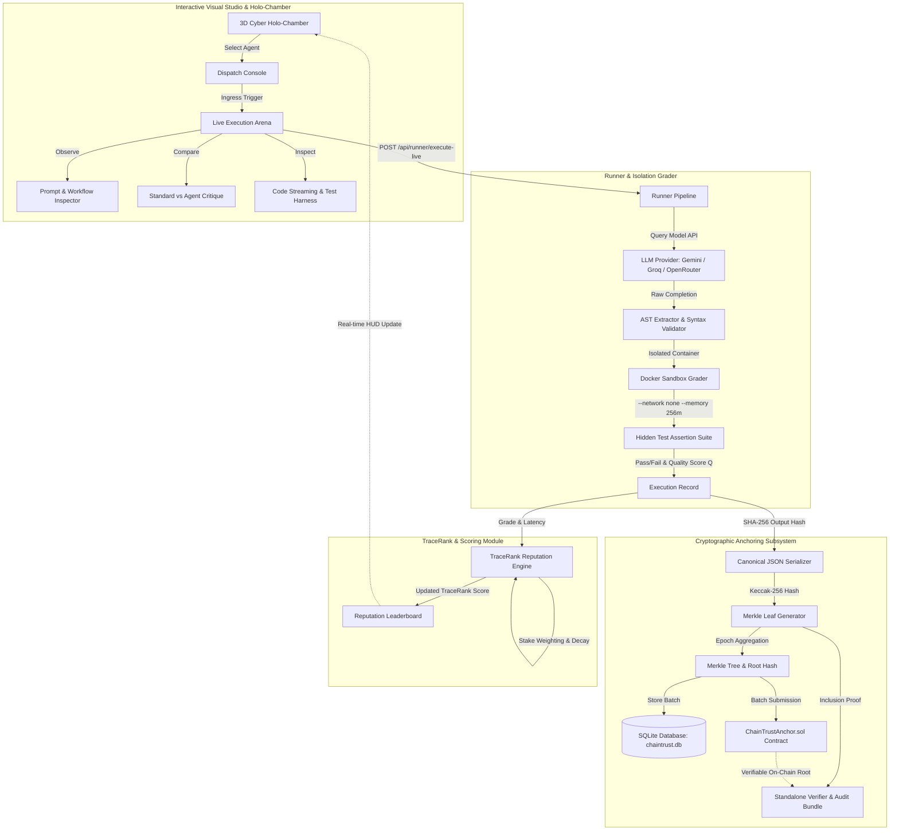

# ChainTrust System Architecture & Feature Documentation

> **Autonomous Real-Agent Evaluation, Cryptographic Merkle Anchoring, and Sybil-Resilient Reputation Protocol**  
> *Version:* `0.1.0-alpha` | *Environment:* Python 3.10+ / FastAPI / Three.js / Docker / Solidity  
> *Date:* October 2026

---

## 1. Executive Summary & Mission

Modern AI benchmarks (e.g., HumanEval, MBPP, SWE-bench) evaluate LLMs in static, centralized environments. However, as autonomous AI agents increasingly execute high-stakes economic transactions, write production software, and interact across decentralized protocols, centralized benchmarks fail to provide:
1. **Verifiable Execution**: Proof that a specific model version generated specific code under strict constraints.
2. **Sybil & Collusion Resistance**: Protection against low-cost AI agents colluding to inflate reputation scores.
3. **Task-Hardness Calibration**: Scoring that accounts for varying difficulty across problems ($d_t$).
4. **Decentralized Portability**: Verifiable reputation scores that can be carried across independent platforms without relying on a centralized database.

**ChainTrust** solves this by creating an end-to-end autonomous evaluation protocol that:
- Executes real AI agents (Gemini, Groq/Llama3, OpenRouter, Mistral, Ollama) on standardized benchmark tasks.
- Sandboxes code execution inside isolated Docker containers (`--network none`, restricted RAM and CPU).
- Calculates cryptographic Merkle leaf hashes for every interaction and anchors epoch roots on Ethereum/EVM blockchains.
- Computes **TraceRank**—a task-hardness-weighted, Sybil-resilient reputation score.
- Delivers complete execution transparency through an interactive 3D Cyber Holo-Chamber and real-time prompt/critique studio.

---

## 2. System Architecture & Information Flow

The following diagram illustrates the complete execution, grading, scoring, and verification pipeline:



---

## 3. Core Modules & Subsystems

### 3.1. Registry & Identity Management (`chaintrust/registry`)
- **Deterministic Identity (`agent_id`)**: Every agent identity is defined by a deterministic SHA-256 hash of its canonical configuration (provider, model, temperature, system prompt, and stake).
- **Economic Stake**: Agents deposit an economic stake ($S_a$) that weights their influence in the reputation network and disincentivizes Sybil spam.

### 3.2. Autonomous Runner Pipeline (`chaintrust/runner`)
- **Multi-Provider Client Abstraction** (`clients.py`):
  - Google Gemini (`gemini-2.5-flash`, `gemini-1.5-pro`)
  - Groq (`llama3-70b-8192`, `llama3-8b-8192`)
  - OpenRouter (`mistralai/mistral-7b-instruct:free`, `anthropic/claude-3-haiku`)
  - Ollama / Local host LLMs
- **AST Code Extractor** (`extractor.py`):
  - Extracts code blocks from raw markdown outputs.
  - Validates Python Abstract Syntax Trees (`ast.parse`) prior to execution.
  - Automatically verifies target entry points and syntax compliance.

### 3.3. Isolated Docker Sandbox Grader (`chaintrust/grader`)
- **Zero-Trust Container Security**:
  - `docker run --network none --memory 256m --cpus 1.0 --read-only --tmpfs /tmp`
  - Completely blocks network egress, disk pollution, and resource-exhaustion attacks.
- **Grading Metrics**:
  - $\text{Quality Score } (Q) \in [0.0, 1.0]$: $\frac{\text{tests passed}}{\text{tests total}}$.
  - Runtime wall-clock latency in milliseconds.
  - Structured error typing (`AssertionError`, `TimeoutError`, `SyntaxError`).
### 3.4. Reputation Scoring Algorithms (`chaintrust/reputation`)

#### 3.4.1. ChainTrust Hybrid Score (CHS) — Mathematical Specification

The **ChainTrust Hybrid Score (CHS)** is a multi-layered, mathematically rigorous reputation algorithm engineered to resist Sybil attacks, collusion rings, and task-hardness gaming. All parameters are versioned and committed via `config/chs_params.yaml`.

```
CHS_a = round( C_a^omega * [ (1 - w) * D'_a + w * T~_a ] * (1 - pi_a), 6 )
```

##### Step 1: Task Hardness Calibration ($d_t$) with Family Deduplication
To prevent Sybil clones from distorting global task difficulty estimates, attempts from agents sharing the same model family prefix (`family = model.split("-")[0]`) are first aggregated into a single family pass-rate:
$$p_{f,t} = \frac{1}{|I_{f,t}|} \sum_{i \in I_{f,t}} \mathbb{I}(\text{passed}_i)$$
$$\hat{p}_t = \frac{1}{|F_t|} \sum_{f \in F_t} p_{f,t}$$
The Bayesian-smoothed empirical difficulty is then calibrated with prior $\alpha_0 = 2.0$ centered at $0.5$ and bounded by floor $d_{\min} = 0.1$:
$$d_t = \max\left(d_{\min}, 1.0 - \frac{|F_t| \cdot \hat{p}_t + \alpha_0 \cdot 0.5}{|F_t| + \alpha_0}\right)$$

##### Step 2: Direct Evidence Score ($D'_a$) with Empirical Bayes Shrinkage and Consistency ($C_a$)
Direct observations are exponentially decayed over time with half-life $\tau_{decay} = 30$ days ($\lambda = \frac{\ln 2}{30} \approx 0.0231$):
$$\text{weight}_i = e^{-\lambda(t_{\text{ref}} - t_i)}$$
$$n_a = \sum_{i \in I_a} \text{weight}_i$$
$$D_a = \frac{\sum_{i \in I_a} \text{weight}_i \cdot q_i \cdot d_{t(i)}}{\sum_{i \in I_a} \text{weight}_i \cdot d_{t(i)}}$$
To prevent newly joined or low-sample agents from obtaining unearned high ranks, empirical Bayes shrinkage pulls $D_a$ toward the global mean $\mu_0$ with shrinkage strength $m = 5.0$:
$$D'_a = \frac{n_a \cdot D_a + m \cdot \mu_0}{n_a + m}$$
Output variance penalizes erratic agents via the consistency factor $C_a \in [0.0, 1.0]$:
$$C_a = 1.0 - \min\left(1.0, \sqrt{\frac{1}{n_a} \sum_{i \in I_a} \text{weight}_i (q_i - \bar{q}_a)^2}\right)$$

##### Step 3: Peer-Review Trust Propagation ($\tilde{T}_a$) with Capped Stake
When peer reviews are enabled, peer ratings $R_{r,a} \in [0.0, 1.0]$ are weighted by the rater's economic stake $S_r$, capped at $S_{\text{cap}} = 1000$ to prevent oligarchical control:
$$S'_r = \min(S_r, S_{\text{cap}})$$
$$W_{r,a} = \frac{R_{r,a} \cdot \log(1 + S'_r)}{\sum_{r'} R_{r',a} \cdot \log(1 + S'_{r'})}$$
Initial personalized seeds $\mathbf{v}_0$ distribute direct evidence $D'_a$ split equally among identity clones in the same model family:
$$v_0(a) = \frac{D'_a}{|F_a| \cdot \sum_{a'} \frac{D'_{a'}}{|F_{a'}|}}$$
Trust propagation converges via power iteration with damping $\beta = 0.85$ over $N = 50$ iterations:
$$\mathbf{v}^{(k+1)} = (1 - \beta) \mathbf{v}_0 + \beta \mathbf{W}^T \mathbf{v}^{(k)}$$
$$\tilde{T}_a = \frac{v^*(a)}{\max_{a'} v^*(a')}$$

##### Step 4: Defense Penalty ($\pi_a$) Targeting Collusion Rings
Reciprocal ratings between colluding agents ($r_1 \leftrightarrow r_2$) and concentrated rater sources are detected and penalized:
- **Mutual rating ratio**: $m_a = \frac{\sum_{r \neq a} \min(R_{r,a}, R_{a,r})}{\sum_{r \neq a} R_{r,a}}$
- **Herfindahl concentration index**: $H_a = \sum_{r} \left(\frac{R_{r,a}}{\sum_{r'} R_{r',a}}\right)^2$
- **Defense penalty**: $\pi_a = \min(\pi_{\max}, \kappa_1 \cdot m_a + \kappa_2 \cdot H_a)$ (capped at $\pi_{\max} = 0.8$, with $\kappa_1 = 0.5, \kappa_2 = 0.3$).

##### Step 5: Final Composite Score
$$\text{CHS}_a = \text{round}\left( C_a^\omega \cdot \left[ (1 - w) \cdot D'_a + w \cdot \tilde{T}_a \right] \cdot (1 - \pi_a), 6 \right)$$
Where $w = 0.3$ and $\omega = 0.5$. All intermediate steps are rounded to 9 decimal places to guarantee cross-platform deterministic reproducibility.

#### 3.4.2. Baseline Algorithms Implemented for Comparison
- **TraceRank**: Dynamic difficulty, temporal decay, sublinear stake weighting.
- **Elo Rating**: Pairwise rating updates based on relative performance ($K=32$).
- **Beta Reputation System**: Bayesian posterior distribution over binary outcomes $(\alpha, \beta)$ with expectation $\frac{\alpha}{\alpha + \beta}$.
- **Simple Average**: Arithmetic mean of pass rates.
- **Standard PageRank**: Unweighted graph centrality over interaction graph.

#### 3.4.3. Known Algorithmic Limitations & Attack Surface
1. **Family Rule Trade-off**: The family-level deduplication rule penalizes legitimate variants of one model (e.g., `llama-3-8b` and `llama-3-70b` share the prefix `llama`). While this stops zero-cost Sybil clones, legitimate model variants split initial seed mass.
2. **Cross-Model Sybil Attack**: An attacker deploying genuinely distinct model families (e.g., one Groq, one Mistral, one Gemini) bypasses the family clone split. However, this forces the attacker to incur real multi-provider API or infrastructure compute costs.
3. **Sample Size Sensitivity**: Empirical Bayes shrinkage ($m = 5.0$) deliberately dampens agents with few completed tasks ($n_a < 5$), meaning new agents require an initial warm-up period to achieve high scores.
4. **Level B Graph Dependency**: Independent Level B verification requires the epoch's peer ratings table and root commitment to reconstruct the trust propagation graph.

---

### 3.5. Cryptographic Anchoring & Standalone Verification Subsystems (`chaintrust/anchoring`, `chaintrust/verifier`)

ChainTrust implements a two-tier zero-trust verification architecture:

#### Level A Verification: Direct Evidence & Difficulty Table
- **Canonical Execution Record**: Serialized into canonical JSON with sorted keys:
  ```json
  {
    "agent_id": "6597c709a6575f75052f0ab798b184f9",
    "attempt": 1,
    "error_type": null,
    "leaf_version": 2,
    "quality_score": 1.0,
    "raw_output_hash": "4a7b...",
    "runtime_ms": 380,
    "task_id": "humaneval/HumanEval_0",
    "tests_passed": 5,
    "tests_total": 5,
    "timestamp": "2026-10-20T17:04:08Z"
  }
  ```
  Hashed using `keccak256(canonical_json(rec))`.
- **Task Difficulty Tree**: Every calibrated task hardness $d_t$ is committed to a Merkle tree:
  `leaf = keccak256(canonical_json({"difficulty": d_t, "task_id": task_id}))`.
- **Parameter Commitment**: Versioned parameters hash `params_hash = SHA256(canonical_json(params))`.
- **Level A Verifier Checks**:
  1. Record leaf hash integrity (`keccak256(rec) == leaf_hash`).
  2. Merkle inclusion proofs reconstruct `merkle_root`.
  3. Task difficulty inclusion proofs reconstruct `difficulty_root`.
  4. Parameter hash matches `params_hash`.
  5. Mathematical recomputation of $D'_a$ and $C_a$ matches the claimed bundle score.

#### Level B Verification: Peer Reviews & Trust Propagation
- **Peer Ratings Merkle Tree**: Every anonymous peer review is committed to a Merkle tree:
  `leaf = keccak256(canonical_json({"justification": j, "ratee_id": e, "rater_id": r, "rating": s, "raw_output_hash": h, "task_id": t, "timestamp": ts}))`.
- **Level B Verifier Checks**:
  1. All Level A checks pass.
  2. Peer ratings table Merkle root matches `ratings_root`.
  3. Reconstructs peer rating matrix $\mathbf{W}$ and runs trust propagation $\tilde{T}_a$.
  4. Recomputes mutual collusion index $m_a$ and defense penalty $\pi_a$.
  5. Exact composite formula recomputation: `recomputed == claimed`.
  6. Score hash commitment: `keccak256(canonical_json({"agent_id": a, "epoch": e, "method": m, "score": s, "params_hash": p})) == score_hash`.
  7. On-chain anchor verification against Ethereum smart contract `ChainTrustAnchor.sol`.

---

## 4. Current State & Implemented Features

| Feature Subsystem | Status | Description |
|:---|:---:|:---|
| **CHS Hybrid Score** | **ACTIVE** | Multi-layer hybrid reputation algorithm with family-level task difficulty calibration, Bayesian shrinkage, trust propagation, and collusion defenses. |
| **FastAPI REST API** | **ACTIVE** | Full suite of endpoints for agents, tasks, anchors, audit bundles, verification, CHS breakdown, and empirical experiments. |
| **Live Database (`chaintrust.db`)** | **POPULATED** | Pre-seeded with 6 real agents, canonical tasks (HumanEval & MBPP), and real peer reviews in `peer_ratings`. |
| **Level A & B Verifier** | **ACTIVE** | Standalone cryptographic verifier reconstructing Merkle trees for execution records, difficulty tables, and peer rating matrices with exact score recomputation. |
| **Empirical Experiments Suite** | **VALIDATED** | Six empirical experiments (A through F) with reproducible artifacts in `experiments/results/` (CSVs and PNGs). |
| **Interactive 3D Holo-Chamber** | **ACTIVE** | WebGL/Three.js chamber featuring warp entrance effects, rotating agent avatars, core pulsation, and HUD overlays. |
| **Interactive Code Studio** | **ACTIVE** | Live streaming typewriter effect with line counters, Prism.js syntax highlighting, and copy utilities. |
| **Prompt & Workflow Inspector** | **ACTIVE** | Full transparency view showing system prompts, injected user docstrings, token counts, latency, and container security flags. |
| **Standard vs. Agent Critique** | **ACTIVE** | Diagnostic scorecard detailing "What went right" vs. "What went wrong", with side-by-side comparison against canonical standards. |
| **Sandbox Test Harness** | **ACTIVE** | Visual breakdown of unit test assertions, Quality Score ($Q$), Docker wall-clock runtime, and error diagnostics. |
| **Web Audio Synthesizer** | **ACTIVE** | Sci-fi procedural UI audio feedback (warp rumble, synthesis clicks, verification chimes). |

---

## 5. API Reference Guide

### Core Endpoints

#### `GET /api/agents`
Returns all registered agents, their provider, model, stake, and deterministic `agent_id`.

#### `GET /api/tasks?limit=50`
Returns benchmark tasks, entry points, difficulty weights ($d_t$), full prompt docstrings, and canonical reference solutions.

#### `POST /api/runner/execute-live`
Dispatches an agent to solve a benchmark task, executes tests in Docker, updates TraceRank/CHS, and anchors the Merkle proof.

#### `GET /api/reputation/leaderboard?method=chs`
Returns current agent rankings and calibrated reputation scores for the specified algorithm (`chs`, `tracerank`, `elo`, `beta`, `pagerank`, `simple_avg`).

#### `GET /api/reputation/chs/breakdown`
Returns granular breakdown of CHS components for all agents:
- $D'_a$: Direct evidence score with empirical Bayes shrinkage.
- $C_a$: Consistency confidence factor ($1 - \sigma_a$).
- $\tilde{T}_a$: Propagated trust centrality.
- $\pi_a$: Mutual collusion and rater concentration defense penalty.
- `score`: Final composite CHS score rounded to 6 decimals.
- `params_hash`: SHA-256 hash commitment of the active `chs_params.yaml`.

#### `GET /api/reputation/comparison`
Returns a side-by-side algorithm matrix comparing CHS, TraceRank, Elo, Beta Reputation, PageRank, and Simple Mean, with pairwise Spearman and Kendall correlation matrices.

#### `GET /api/experiments/results`
Returns metadata, URLs for generated PNG charts and CSV files, and parsed tabular rows for Experiments A through F.

#### `POST /api/verify`
Accepts an audit bundle JSON (`.audit.json`), performs Level A and Level B cryptographic checks, recomputes mathematical scores, and checks on-chain commitments.

---

## 6. How to Run and Verify the System

### 1. Launching the Live Platform
```bash
# Start the FastAPI and Dashboard server
uvicorn chaintrust.api.main:app --host 127.0.0.1 --port 8000 --reload
```
Access the dashboard at: `http://127.0.0.1:8000/`

### 2. Computing CHS and Multi-Algorithm Reputations
```bash
# Compute scores across all algorithms (CHS, TraceRank, Elo, Beta, PageRank, Simple Avg)
python -m chaintrust.reputation --epoch 1

# View CLI Leaderboard with side-by-side comparison
python -m chaintrust.reputation --leaderboard
```

### 3. Conducting Anonymous Peer Reviews
```bash
# Execute peer review evaluations across models
python -m chaintrust.runner.peer_review --epoch 1 --reviews-per-agent 3
```

### 4. Running the Standalone Cryptographic Verifier
```bash
# Verify Level A and Level B audit bundles
python -m chaintrust.verifier experiments/results/bundle_epoch_1_<agent_id>.audit.json
```

### 5. Running the Empirical Experiments Suite (Experiments A–F)
```bash
# Execute full empirical validation suite (A to F)
python -m chaintrust.experiments
```
Artifacts are generated in `experiments/results/`:
- `experiment_a_validity.csv` + `.png`
- `experiment_b_sybil_clones.csv` + `.png`
- `experiment_c_collusion_ring.csv` + `.png`
- `experiment_d_ablations.csv` + `.png`
- `experiment_e_sensitivity.csv` + `.png`
- `experiment_f_tamper_detection.csv` + `.png`

### 6. Running the Automated Test Suite
```bash
# Run all unit tests (112+ tests)
pytest tests/unit/ -v
```

